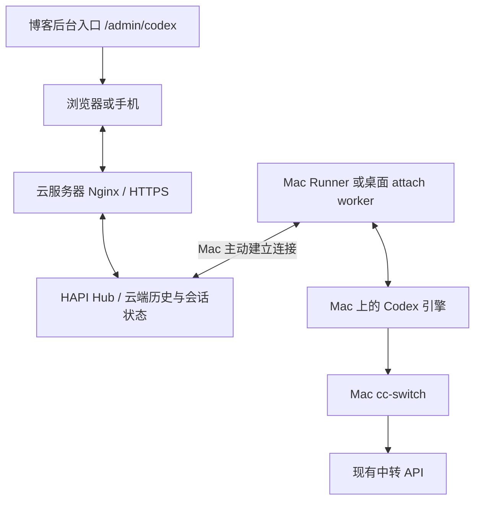

# HAPI 验证与博客接入设计

日期：2026-11-17（Asia/Shanghai）

状态：第一版云端与隔离桌面双向同步、手机跨网已通过；博客入口已发布。Runner 后台新建 CLI 超时，已停用；首版采用独立桌面 attach worker。完整证据与未验证项见验收记录。

## 目标与已选路线

用户选择先验证 HAPI，再接入个人博客。需要从网页查看 Mac 上 Codex 的输出、执行进度和历史，继续同一聊天，并沿用本机 cc-switch 的模型与中转 API 配置。

采用两阶段路线：先在 Mac 完成隔离验证，随后部署云端 Hub，Mac 作为执行节点，博客后台提供控制台入口。第一版使用 HAPI 原有网页，暂不重写聊天前端。

必须分别报告两个结论：

- CLI 共享会话：由 HAPI 启动的 Codex，终端与网页共享同一个引擎。
- 桌面桥接：连接官方桌面 App 已加载的测试聊天，验证两端继续对话。CLI 通过不能替代桌面桥接通过。

## 执行前基线（历史快照）

| 项目 | 证据与状态 |
| --- | --- |
| 博客 | Vue 3 + FastAPI；生产 Compose 与宿主机 Nginx；后台路由要求登录和管理员权限 |
| Mac | 本次对话只读检查：Codex CLI `0.163.0`、CC Switch `4.0.18`、ChatGPT App `26.1111.21308` / build `27194` |
| 模型路由 | 本机 Codex 配置指向 `http://127.0.0.1:15721`，协议 `responses`；真实请求尚未验证 |
| HAPI | 2026-11-17 查询 npm 与 GitHub Release 均为 `0.36.4`；Mac 尚未安装 |
| 桌面端点 | 先前检查默认 control 目录未发现 `.sock`；不能据此断言所有端点均不存在，执行时需要按实际 App 进程再核查 |
| 服务器与域名 | 仓库约定为 `root@39.96.212.169`、`/srv/personal-blog`、`guoer9.me`；当前线上 DNS、证书、服务状态未核验 |

HAPI 验证固定使用 `0.36.4`，不混用主分支和其他 Hub / Runner 版本。执行前若发现该版本已有直接影响此任务的缺陷，先记录证据并统一选择替代版本。

## 架构与数据位置

- 云端 Hub：网页、HAPI 投影视图与历史、认证和连接管理；独立用户运行，监听 `127.0.0.1:3006`。
- Mac：项目文件、Codex 原生会话数据、工具执行、cc-switch 与模型凭据。Hub 不承接 Mac 进程的内存和运行环境。
- 第一轮本地验证使用 `HAPI_HOME=/Users/guoer/.hapi-poc` 和独立测试工作区；CLI 验证另用隔离 `CODEX_HOME`，只导入模型路由必需设置。
- 正式 Mac 节点使用 `/Users/guoer/.hapi-blog`；云端 Hub 使用 `/var/lib/hapi`。本地 PoC 历史不混入正式 Hub。
- 拟用控制台地址为 `https://codex.guoer9.me`；已部署并通过 HTTPS / 手机跨网验证。

Mac 主动连接云端 Hub 时通常不需要 FRP。若改成云端反代 Mac 本地 Hub，则另行配置隧道；该替代路线会使 Hub 数据仍位于 Mac，不作为本方案的云端持久化实现。

## 方案取舍

| 路线 | 取舍 |
| --- | --- |
| 云端 Hub + Mac 执行节点（采用） | 历史留在云端，模型配置沿用 Mac；Mac 离线时无法继续执行 |
| Mac Hub + 穿透 | 初期组件少，但 Mac 离线时网页与历史入口也受影响 |
| 云端运行另一个 Codex | 可独立持续运行，但要单独准备项目、工具和模型配置，不能自动接管 Mac 的运行中会话 |

博客第一版在管理员后台增加入口，打开独立子域名 HAPI 控制台，保留 HAPI 自己的认证。博客登录与 HAPI 登录是两套认证；这一版不承诺单点登录、iframe 嵌入或统一聊天 UI。

## 验证标准

1. 新测试会话中，终端和网页双向消息各出现一次；记录同一 native thread ID 与 HAPI session ID 的对应关系。
2. 流式文本、测试命令输出、完成和中断状态可见；浏览器刷新后无丢失或重复。
3. 在 App 创建单独测试聊天，通过兼容端点 attach；两端双向对话、运行进度、detach 后原 App 继续工作。
4. cc-switch 中能确认测试请求实际经过本地路由；模型切换按已验证的生效时机执行，不承诺所有运行中引擎自动热加载。
5. 云端 Hub 保存已完成历史；Mac 断线后历史可查、执行状态真实，恢复后不重复执行不确定是否已送达的消息。
6. 未登录访问会话 API 被拒绝；云端代理正确传递 SSE 与 Socket.IO，日志不记录事件流查询参数中的 token。
7. 博客入口仅管理员可见；控制台直访仍由 HAPI 独立鉴权；已有博客主要功能通过回归检查。

桌面桥接是实验性能力。上游发布文档中的桌面测试采用模拟模型，不能当作本机真实 API 验收。若实际 App 不暴露兼容端点，先记录连接条件和最小调整；需要重启当前使用的 App 时安排空闲窗口，不中断正在进行的任务。不得用第二个引擎恢复同一活跃线程冒充共享。

## 阶段准入与失败处理

- 本地 CLI 通过：仅说明 CLI 路线可行，继续桌面验证。
- 桌面桥接通过：才进入用户所需桌面同步路线的云端和博客接入。
- 桌面桥接失败：保留 CLI 可用结论，报告具体阻碍；用户选择接受 CLI 工作流后才更改目标继续。
- 云端恢复、真实路由或认证未通过：修复对应链路，暂不接入博客。
- Mac 睡眠或关机：云端仍保留已同步记录；Mac 上的执行受系统状态影响，不宣称在云端自动续跑。

## 参考资料

- [HAPI v0.36.4 发布](https://github.com/tiann/hapi/releases/tag/v0.36.4)
- [该版本的 Codex 共享会话与桌面桥接](https://github.com/tiann/hapi/blob/v0.36.4/docs/guide/codex-shared-sessions.md)
- [该版本安装、配置和远程 Hub](https://github.com/tiann/hapi/blob/v0.36.4/docs/guide/installation.md)
- [该版本部署说明](https://github.com/tiann/hapi/blob/v0.36.4/docs/guide/deployment.md)
- [事件流认证实现：允许 query token](https://github.com/tiann/hapi/blob/v0.36.4/hub/src/web/middleware/auth.ts)
- [Codex app-server 官方协议](https://learn.chatgpt.com/docs/app-server)
- [cc-switch 配置说明](https://github.com/farion1231/cc-switch/blob/main/docs/user-manual/en/5-faq/5.1-config-files.md)

操作步骤、文件清单与回退见 [执行计划](../plans/2026-11-17-hapi-codex-blog.md)。
